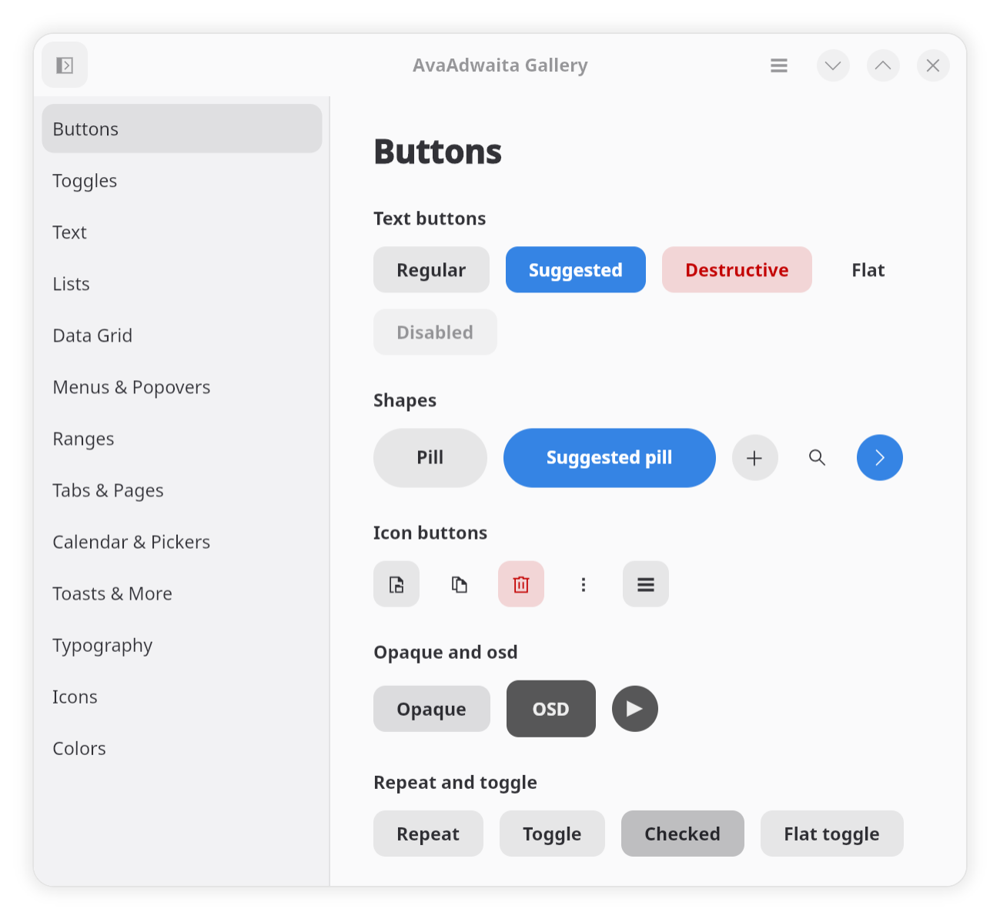

# AvaAdwaita

[](https://www.nuget.org/packages/AvaAdwaita.Theme/) 

AvaAdwaita is an experimental them for [Avalonia](https://avaloniaui.net) 12
that binds [libadwaita](https://gnome.pages.gitlab.gnome.org/libadwaita/).
Using libadwaita's stylesheet (`gtk.css`) through a managed GTK CSS engine, 
it draws Avalonia's stock controls from its CSS node trees. Along with
mapping from GTK, it helps Avalonia apps match to Adwaita designs.



To see it live, go to [live gallery demo](https://drasticactions.github.io/AvaAdwaita),
or download the [AppImage](https://github.com/drasticactions/AvaAdwaita/actions/workflows/appimage.yml).

## Packages

| Package | |
|---|---|
| `AvaAdwaita.Theme` | The theme, the CSS engine, settings, chrome and ControlThemes. |
| `AvaAdwaita.Fonts` | Optional. Adwaita Sans and Adwaita Mono (OFL-1.1). |
| `AvaAdwaita.DataGrid` | Optional. Avalonia's `DataGrid` as a GTK column view. |

## Getting started

```xml
<Application xmlns="https://github.com/avaloniaui"
             xmlns:adw="https://github.com/avaadwaita">
  <Application.Styles>
    <adw:AdwaitaTheme />
  </Application.Styles>
</Application>
```

```csharp
public static AppBuilder BuildAvaloniaApp() => AppBuilder.Configure<App>()
    .UsePlatformDetect()
    .UseAdwaitaFonts()   // optional, from AvaAdwaita.Fonts
    .WithAvaAdwaita();
```

```xml
<Application.Styles>
  <adw:AdwaitaTheme />
  <adw:AdwaitaDataGridTheme />
</Application.Styles>
```

It also provides window decorations:

```xml
<Window adw:HeaderBar.Title="Files">
  <adw:HeaderBar.End>
    <Button><adw:AdwIcon IconName="open-menu-symbolic" /></Button>
  </adw:HeaderBar.End>
  …
</Window>
```

And you can also override the global themes:

```xml
<adw:AdwaitaTheme ColorScheme="PreferDark" AccentColor="Purple" HighContrast="System" CssSource="Auto" />
```

You can allow for following a users global `$XDG_CONFIG_HOME/gtk-4.0/gtk.css`:

```csharp
.WithAvaAdwaita(new AvaAdwaitaOptions { LoadUserStyleSheet = true })
```

Values the stylesheet computes are available as resources
(`{DynamicResource Adw.AccentBgColorBrush}`, `Adw.WindowRadius`,
`Adw.Named.accent_color`) and, for any node, through
`{adw:Css Background.Color}`. See [docs/theme-authoring.md](docs/theme-authoring.md).

## Environment variables

| Variable | Effect |
|---|---|
| `AVAADWAITA_CSS=bundled\|installed` | Force the stylesheet source. |
| `ADW_DEBUG_COLOR_SCHEME=prefer-dark\|prefer-light\|default` | As libadwaita. |
| `ADW_DEBUG_ACCENT_COLOR=blue\|teal\|…` | As libadwaita. |
| `ADW_DEBUG_HIGH_CONTRAST=1` | As libadwaita. |

## Building

```sh
git submodule update --init --depth 1
dotnet build AvaAdwaita.slnx                     # libraries and tests
dotnet run --project tests/AvaAdwaita.Theme.Tests
dotnet run --project samples/AvaAdwaita.Gallery.Desktop   # AvaAdwaita.Samples.slnx
```

Tools:

- `tools/build-stylesheet.sh` rebuilds the bundled `gtk.css` from
  `external/libadwaita` with `sassc`.
- `dotnet run tools/adw-css-props/adw-css-props.cs` regenerates the
  property table, the computed style and `docs/css-support.md`.
- `tools/adw-dump` prints the computed style of a node path.
- `tools/adw-oracle` is the GTK program that produces the parity data;
  `tools/regenerate-data.sh` runs it.
- `tools/shoot.sh` renders every gallery page to PNG.
- `tools/publish-local.sh` installs the packages into the local NuGet cache.
- `tools/build-appimage.sh` packs the desktop gallery as an AppImage in
  `artifacts/appimage/`; the Gallery AppImage workflow runs it for x64 and arm64.

## Documentation

- [Architecture](docs/architecture.md)
- [Writing ControlThemes](docs/theme-authoring.md)
- [CSS support](docs/css-support.md) (generated)
- [Moving to a new libadwaita](docs/libadwaita-releases.md)

## LLM Usage

LLMs were/are used in the construction of the generator tooling, CI, samples, and portions of the documentation.

## License

`LGPL-2.1-or-later`
