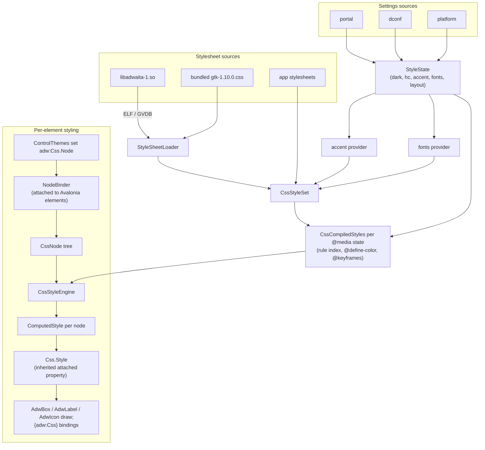

# Architecture

AvaAdwaita has four parts: a GTK CSS engine, the sources that feed it
(stylesheet and settings), a CSS node tree laid over Avalonia's visual tree,
and the presenters and ControlThemes that draw from computed styles.

## The CSS engine (`Css/`, namespace `AvaAdwaita.CssEngine`)

- **Syntax** — a CSS Syntax Level 3 tokenizer and component parser with
  GTK's extensions (`@define-color`, `-gtk-*` functions). Errors are kept
  with line and column; a sheet with no errors is *clean*.
- **Selectors** — compounds, combinators, `:not()`, `:dir()`,
  `:nth-child()`, GTK's state pseudo-classes. Specificity as GTK.
- **Rule index** — rules are bucketed by the rightmost compound's id,
  class, then name; a bloom filter of ancestors rejects most descendant
  selectors without walking the tree.
- **Values and properties** — the property table is generated from
  `tools/adw-css-props/properties.yaml`: each property's kind, initial
  value, inheritance, animation and the group of `ComputedStyle` it lives
  in. Shorthands expand to longhands at parse time, or at compute time
  when they hold `var()`.
- **Cascade** — origin, importance, specificity and order; `var()` with
  fallbacks and cycle detection; `inherit`, `initial`, `unset`, `all`.
- **Colors** are computed in floating point with the color space and
  missing components kept, as GTK. `currentColor` resolves at compute time;
  an inherited property that depends on it is recomputed in children whose
  `color` differs.
- **Computed styles** are interned per group, so siblings with the same
  matches share objects and an unchanged node returns the same instance;
  equality is a reference check in the common case.

### Parsing cost and the preload

Measured on the development machine (`PerformanceTests`), libadwaita
1.10.0's `gtk.css` (447 KB, 1,616 rule blocks):

| | Time |
|---|---|
| Parse, warm, lazy | ~20 ms |
| Parse, warm, every block | ~46 ms |
| Parse, cold process (JIT) | ~80 ms (ReadyToRun ~50 ms) |
| First resolve of a 2,001-node tree (with JIT) | ~35 ms |
| Restyle all 2,001 nodes (window to backdrop) | ~5.3 ms |
| Re-resolve after the stylesheets change | ~5.7 ms |
| Restyle after a hover | 0.014 ms |

`PerformanceTests` asserts the window restyle and the hover at twice the
budgets (10 ms and 0.2 ms), for shared CI machines. Two things keep the
restyle there:

- **Matching** reads, for each candidate rule, a flat record of what its
  subject needs (states, name, classes) and its ancestors' bloom mask, and
  walks the selector only when those pass: about 185 candidates per node,
  of which a few match.
- **The style cache** is keyed by the parent style and the matched rules,
  and keeps the rules with the entry: interned styles are shared by nodes
  that matched different rules, so the rules cannot be kept with the style.

A cold parse is over the 30 ms budget, but the time is JIT, not parsing, so
a binary cache would not help much. Instead:

- **Lazy parsing.** A sheet known to be clean (the bundled one, or an
  installed one whose hash matches the bundled one or a cached clean
  verdict in `$XDG_CACHE_HOME/avaadwaita`) is parsed lazily: style-rule
  blocks are skipped by brace matching and their declarations are parsed
  the first time a node matches the rule.
- **Preload.** `AppBuilder.WithAvaAdwaita()` (or `AdwaitaEnvironment.Preload`)
  loads the stylesheet and reads settings on a background thread while
  Avalonia starts. `AdwaitaTheme` waits for it on first use.

## Stylesheet sources (`Sources/`)

`StyleSheetLoader` looks for `libadwaita-1.so.0` on the loader path, reads
the ELF section headers, finds the GResource bundle and reads
`/org/gnome/Adwaita/styles/gtk.css` and its assets through the GVDB reader.
No native code is loaded. The installed sheet is used when it parses
cleanly; otherwise, or off Linux, the bundled 1.10.0 copy is used.
`AVAADWAITA_CSS` and `AdwaitaTheme.CssSource` force either.

The **runtime providers** are generated per settings state, as
libadwaita's style manager does: the accent provider
(`:root { --accent-color: …; --accent-bg-color: …; }`) and the fonts
provider (`--document-font-*`, `--monospace-font-*`). They are added at
theme priority after `gtk.css`. Application stylesheets come after, at
application priority.

## Settings (`Settings/`)

`StyleState` merges the sources in order: the debug environment variables,
the theme's overrides, the settings portal
(`org.freedesktop.portal.Settings` over `Tmds.DBus.Protocol`), dconf (read
directly from the GVDB database and the compiled schemas), then Avalonia's
`IPlatformSettings`. It raises `Changed` with flags; dark, contrast and
reduced motion select a `CssCompiledStyles` (each `@media` state compiles
once); accent and fonts rebuild the providers.

## The node tree (`Nodes/`)

A ControlTheme sets `adw:Css.Node="button"` on the elements that are GTK
nodes. Each such element gets a `NodeBinder` and a `CssNode`. The node's
parent is the nearest ancestor element with a node; a popup's content is
parented to its window's node. Siblings are kept in visual order so
`:first-child`, `:last-child` and the sibling combinators work.

- **Classes** come from the element's `Classes`, `adw:Css.Classes`, and
  hint providers (`ControlHints`) that add the classes GTK's widgets add
  themselves (`.text-button`, `.image-button`, `.horizontal`).
- **States** come from pseudo-classes (`StateMapper`: `:pointerover` →
  `:hover`, `:pressed` → `:active`, `:checked`, `:disabled`,
  `:focus-visible`, `:selected`, …), from the templated parent when
  `adw:Css.StateSource="TemplatedParent"`, and from the window
  (`:backdrop`).
- **Item position** (`adw:Css.Position="Item"`) uses the container's index
  and count, so virtualized lists still match `:first-child`.

The engine resolves dirty nodes top-down once per dispatcher pass. A node
whose style object did not change leaves its children alone. The resolved
style is written to the inherited attached property `adw:Css.Style`, so
presenters, text and `{adw:Css}` bindings below the node read it.

## Drawing (`Presenters/`)

- `AdwBox` is a decorator that implements GTK's box model for its node:
  `min-width`/`min-height` on the content box, margin, border and padding,
  then draws `background`, `border`, `outline` and `box-shadow`
  (`BoxPainter`, with GTK's rounded-rect maths and shadow extents), plus
  `opacity`, `filter` and `transform` (`NodeEffects`).
- `AdwLabel` draws text with the node's `color`, `font`, `line-height`,
  `text-decoration` and `font-variant-numeric`.
- `AdwIcon` draws `-gtk-icon-source` (`-gtk-icontheme()` names through the
  icon providers, or `url()` assets) recolored from the symbolic palette.
- `TransitionDriver` runs CSS transitions: when a new style changes a
  property that `transition-property` covers, the shown style interpolates
  from the current value over the duration and timing function.

Shadow blur: GTK blurs with a box-blur approximation of a Gaussian of
standard deviation `radius / 2`; Skia's blur takes a sigma, so
`BoxPainter.AvaloniaBlur` converts. Shadow extents (how far a shadow reaches
outside the box) follow `gtk_css_shadow_value_get_extents`.

## Window chrome (`Chrome/`)

The Window ControlTheme reproduces `AdwApplicationWindow`'s tree
(`window.csd > dialog-host > widget > widget > toolbarview > revealer.top-bar
> windowhandle > box > headerbar`). `WindowChrome` sets `.csd` (or `.ssd` when the system decorates the window, for libadwaita's `window.ssd` hairline),
`.maximized` and `.fullscreen`, and computes the shadow space from the
window node's `box-shadow` so the platform's drawn decorations put the
shadow outside the window geometry. `HeaderBar.Start`/`End`/`Title` fill
the header bar; `ButtonLayout` reads `org.gnome.desktop.wm.preferences
button-layout`.

## Resources (`Resources/`)

`AdwResourceProvider` serves every custom property computed on a `window`
node as `Adw.<PascalName>` (and a brush), every `@define-color` as
`Adw.Named.<name>`, the fonts, and a few Fluent keys so third-party
controls written against Fluent follow. `VariantFollower` sets
`Application.RequestedThemeVariant` from the dark state.

The Fluent keys, and what they are:

| Key | Value |
|---|---|
| `SystemAccentColor`, `SystemAccentColorLight1`–`3`, `SystemAccentColorDark1`–`3` | `--accent-bg-color` (one color for all seven) |
| `SystemControlHighlightAccentBrush` | `Adw.AccentBgColorBrush` |
| `TextFillColorPrimaryBrush`, `SystemControlForegroundBaseHighBrush` | `Adw.WindowFgColorBrush` |
| `SystemControlBackgroundAltHighBrush`, `SystemRegionBrush` | `Adw.WindowBgColorBrush` |
| `AdwSelectionBrush` (AvaAdwaita's own) | the accent background at 30 %, as `selection:focus-within` |